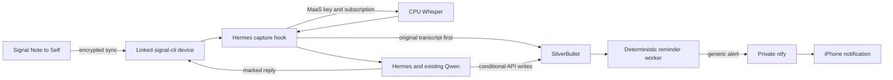

# Signal personal notes and reminders

This is a GitOps extension to the existing Hermes pilot. SilverBullet, ntfy and CPU Whisper through MaaS are deployed; self-hosted iPhone push and authenticated transcription are verified. Deploy this Hermes integration before linking Signal and testing scheduled reminders. OpenClaw and Hermes's shared Qwen configuration remain unchanged.

## Flow



Signal uses your existing account, linked as a device; no second number is needed. Only Note to Self inputs are accepted. The guard rejects other chats before Hermes downloads their attachments, and outgoing messages are restricted to your account. The linked Signal device itself is still an endpoint for your account and can receive/decrypt synced account traffic. Its keys and message state live in a separate 2 GiB PVC that is not mounted in the agent container. Homelab administrators and the linked endpoint must be trusted.

Text and audio are saved as immutable captures before the LLM acts. Audio goes exclusively to the CPU MaaS route. A transcription or capture-write failure drops the agent turn and returns a concise failure message. No hosted provider or native local STT fallback is used. The pinned Hermes native transcription path cannot use this custom endpoint cleanly with the existing projected credential setup; the small capture plugin sends a fresh key from `/maas/MAAS_API_KEY` using the installed OpenAI client and also enforces capture-before-action.

The pinned Signal adapter uses a volatile echo-timestamp cache. `signal_guard.py` adds `[Hermes reply]` to each outbound chunk before sending and drops these echoed messages even after restart. It also retains the original Signal timestamp as the source ID. This is a small, version-specific adapter shim: retest it, plugin hooks, and discovery when upgrading Hermes. Do not end your own input with the reserved reply marker.

## Deployment sequence

Follow [AGENTS.md](../../../../AGENTS.md): review before committing, human push, then Argo reconciliation. Do not apply local manifests or create test Jobs to bypass that sequence.

1. Completed: the reviewed `containers/whisper-cpu` prerequisite is published for amd64 and arm64.
2. Completed: [SilverBullet](../silverbullet/README.md) and [ntfy](../ntfy/README.md) are deployed as independent Applications. Browser access and self-hosted iPhone push are verified.
3. Completed: the speech backend and MaaS multipart filter are deployed, including the route-precedence correction. Authenticated transcription, missing/invalid credential rejection, spoofed identity-header rejection, nonexistent-subscription rejection, request quotas and existing Qwen chat passed live checks.
4. Review/deploy the Hermes integration, generated ConfigMaps, additional secrets/PVC, networking, and sidecars. This restarts Hermes; no content is imported from OpenClaw. The dashboard remains available before Signal is linked, provided the notes/reminder prerequisites are healthy.
5. Link Signal and retain the working ntfy phone subscription. Then perform the end-to-end checks below.

Applications reconcile independently; sync waves do not order separate Applications. Deploy and verify the speech commit before pushing the Hermes integration commit.

## Link the existing Signal account

On your Mac, install `qrencode` and use the authenticated OpenShift CLI:

```bash
brew install qrencode
oc port-forward -n hermes deployment/hermes 8080:8080
```

In another terminal in this repository:

```bash
python3 kubernetes/ocp-mgmt/applications/hermes/link_signal.py
```

In Signal on the iPhone, open **Settings → Linked Devices → Link New Device** and scan the terminal QR. The script refuses to add another account if one is already linked. It does not save the linking URI or print account credentials. Close the port-forward afterward; the unauthenticated local Signal RPC port has no Service or Route and must not be exposed publicly.

Hermes discovers the single linked account and derives an own-account allowlist. Within roughly 30 seconds the supervisor restarts the dashboard process container and starts the persistent gateway alongside it. Open **Note to Self** and send a short text note first. Both your inputs and marked Hermes replies appear in that conversation. Read [Signal's linked-device guidance](https://support.signal.org/hc/en-us/articles/360007320551-Linked-Devices) for ongoing device requirements. If account discovery reports multiple accounts, startup fails rather than choosing one.

This uses Hermes's native Signal channel with the local `signal-cli` sidecar as its transport (`SIGNAL_HTTP_URL=http://127.0.0.1:8080`). The sidecar needs outbound TCP 443 to both `chat.signal.org` and `grpc.chat.signal.org`; Signal lists both in its [official proxy configuration](https://github.com/signalapp/Signal-TLS-Proxy/blob/main/data/nginx-relay/nginx.conf). During initial linking, the account registered successfully but key refresh and receive connections failed with `Closed unexpectedly`: `chat.signal.org` connected while both IPv4 addresses for `grpc.chat.signal.org` timed out. Keep both names in the egress allowlist. A successful QR scan alone does not verify message delivery; test a Note to Self message after deployment.

Configure [ntfy](../ntfy/README.md) on the phone separately. A Signal Note to Self reply is not the reminder notification mechanism. Alerts use only your authenticated `personal-reminders` topic.

## Notes and task conventions

| Path | Purpose |
|---|---|
| `Inbox/Captures/ID.md` | Original transcript/text, source ID, timestamp, Toronto timezone, low-confidence flag |
| `Inbox/Plans/ID.md` | Frozen JSON operation list; retries reuse it exactly |
| `Inbox/Notes/ID.md` | Captured standalone notes |
| `Journal/YYYY-MM-DD.md` | Append-only daily observations with source links |
| `Projects/NAME.md` | Project facts and updates with source links |
| `Tasks/ID.md` | Stable task ID, checkbox status, due date, reminder time, project and source |
| `Tasks.md` | Managed view of open tasks, reminders and delivery failures |
| `System/ReminderReceipts.md` | Managed recovery checkpoint for delivery history |

The first top-level `- [ ]` / `- [x]` checkbox on a task page determines whether it is open or complete. Keep `task_id` unchanged. `due` is an optional date; `remind_at` is an independent ISO date/time with the correct America/Toronto UTC offset. An empty `remind_at` cancels the schedule. Changing it in SilverBullet reschedules the task; checking the task suppresses future delivery. Do not edit `reminder_id` or the managed receipt page. To schedule the same task again after delivery, ask Hermes to snooze it; the tool creates a new reminder revision on the same task.

Task IDs and operation markers derive from the source capture and operation position. Duplicate input processing preserves the first transcript and reuses the frozen plan. A partially applied plan is retried exactly; corrections use a new follow-up capture. Writes use ETags and bounded conflict retries, so a phone edit is reread before the agent appends or updates.

The bundled [Hermes skill](personal-notes/SKILL.md) explains multi-intent extraction, source citations, ambiguous dates and measurements, and truthful partial-failure reporting. Signal's toolset includes the notes tool and excludes workspace file and todo tools. Browser CLI tools remain as configured for the comparison pilot. Preferences may live in Hermes memory; authoritative tasks and journals live in SilverBullet.

Examples:

- “For Garage, the opening is 82 centimetres. Remind me tomorrow at ten to check the fitting size. Journal that today was productive but I spent too long on DNS.”
- “What do I need to do today?” or “What's outstanding for Garage?”
- “I checked the fitting—mark that done.”
- “Remind me again tomorrow at six in the evening.”
- “Summarize this week's journal.”

Material ambiguities must prompt a follow-up before freezing a plan. Toronto daylight-saving gaps are rejected. Both repeated-hour offsets are technically valid, so Hermes must ask which occurrence when the user's wall time is ambiguous. Low-confidence transcription remains visible; it is not silently corrected. Natural-language interpretation still depends on the shared model and must be checked in the live multi-intent test.

## Reminder behavior and recovery

The worker polls every 30 seconds, uses persistent SQLite receipts with WAL and full synchronization, and invokes no language model. Before a due reminder, it rereads the authoritative task and verifies that it is still open with the same reminder revision/time. A phone edit after that final check can race an already in-flight notification.

Delivery uses at most five attempts with bounded exponential delay. A sending lease is persisted before network I/O and checkpointed to SilverBullet. The worker retries an interrupted attempt after its lease expires. Reminders more than 24 hours overdue become visible failures instead of surprising late alerts. Invalid manually edited times are shown on the Tasks dashboard and are never sent. A successful task write confirms a durable schedule, not phone delivery.

A crash after ntfy accepts a message but before the receipt is saved can duplicate an alert: delivery is at least once within the retry limits, not exactly once. Completion/cancellation cannot retract an alert already accepted by ntfy. Service failures appear on the dashboard and in generic worker logs. Worker readiness/liveness uses a successful-reconciliation heartbeat; prolonged notes failures can make the shared Hermes pod unready.

The [SilverBullet backup/restore procedure](../silverbullet/README.md#restore) includes schedules, captures, plans and receipt checkpoints. On an empty local SQLite database, the worker imports the restored receipt page before delivering. Existing SQLite history takes precedence. Restoring older backups can lose newer receipts; inspect schedules before resuming. Signal state is not in the Markdown backup; relink after loss rather than committing keys or exporting them into notes.

## Validation and rollout checks

```bash
python3 -B -m unittest discover -s kubernetes/ocp-mgmt/applications/hermes -p 'test_*.py'
python3 -B -m unittest discover -s kubernetes/ocp-mgmt/applications/whisper-cpu -p 'test_*.py'
python3 -B -m unittest discover -s kubernetes/ocp-mgmt/applications/silverbullet -p 'test_*.py'
kustomize build kubernetes/ocp-mgmt/applications/hermes > /tmp/hermes-rendered.yaml
kustomize build kubernetes/ocp-mgmt/applications/silverbullet > /tmp/silverbullet-rendered.yaml
kustomize build kubernetes/ocp-mgmt/applications/ntfy > /tmp/ntfy-rendered.yaml
# After GitOps reconciliation:
oc get externalsecret,pvc,pods,route -n hermes
oc logs deployment/hermes -n hermes -c reminders --tail=30
oc logs deployment/hermes -n hermes -c dashboard --tail=30
```

Local tests cover capture-before-action, refusal of other senders, STT failure, duplicate processing, partial-plan retry, concurrent note edits, DST validation, due/reminder separation, manual completion/rescheduling, bounded failures, restart suppression, receipt recovery, and self-reply echo prevention. Pinned-image checks cover plugin discovery, actual CPU audio decoding, notes authentication/conflicts/backups, and ntfy topic authorization.

Validation on 2026-10-24 passed 47 tests (39 Hermes, 3 speech, 5 restore), rendered the Hermes, speech, inference-server and MaaS Kustomizations, and passed server-side dry runs for Hermes, speech and the multipart EnvoyFilter. The deployed SilverBullet file-list API accepted its integration credential. The pinned Signal daemon passed its configured readiness probe locally with an arbitrary UID, read-only root, no network and no linked account. The final reminder recheck also verifies task identity and the first top-level checkbox, including completion between the initial scan and delivery.

After GitOps deployed `6d96609`, both gateway replicas placed the exact speech route first with the JSON processors disabled only for that route. The Hermes key transcribed the public JFK sample through MaaS with HTTP 200 in 0.68 seconds. Missing credentials returned 401; invalid keys, spoofed identity headers and a valid OpenShift identity selecting a nonexistent subscription returned 403. Excess speech requests returned 429 after the six-request quota, and Qwen chat still returned 200. This validates the speech prerequisite, not Signal capture or scheduled reminder delivery.

The following require the reviewed GitOps resources and your linked account; they are **not yet verified**:

1. If a valid credential with access only to another model is available, verify it cannot use the `local-llm` speech endpoint. The live subscription-denial check above used a nonexistent requested subscription; it did not exercise that separate case.
2. Send the multi-intent example as a real Signal voice note. Inspect the original capture, Garage update, single stable task, exact Toronto reminder, journal entry, and truthful linked reply.
3. Request a reminder a few minutes ahead and verify it reaches only your ntfy subscription on the locked iPhone. Complete another task before its reminder and verify suppression. Snooze an existing task and verify the same task ID is retained.
4. Retry the same source delivery and original plan without duplicate records. After a reviewed GitOps restart, verify notes, pending schedules, and sent receipts remain; a normal new message saying the same words is a new source, not a duplicate delivery.
5. Check failure responses during a planned service outage, including no false success and no hosted STT fallback. Verify a scheduled NAS backup and a separate recovery exercise.

Use the normal authenticated `oc` context for post-GitOps checks; do not print tokens or transcripts in shared logs. Local and server-side dry-run validation does not replace the live transcription, Signal linking, and scheduled-delivery checks above.
